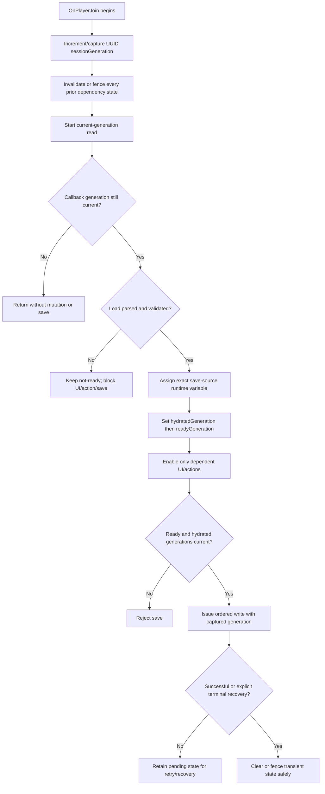

# Data Storage Standards

> **Guide baseline:** `UGC_DataStorage_Creators_Guide_English.pptx` (2026.08).
> This pack keeps current behavior separate from the OB56 plan and treats the
> effective runtime/configuration as the final limit authority.

## Creator Guide Coverage

### Three storage foundations

| Foundation | Ownership | Current use | Review boundary |
|---|---|---|---|
| Automatic Storage | System-managed | Player custom properties, periodic writes, save-on-exit | Outside Standard Storage quota; up to 10 fields, primitives/lists of primitives, 5 s auto-write, 4 KB error boundary |
| Standard Storage | Creator-controlled | Four table types: Regular, Multi-column, Leaderboard, Accumulation | Creator owns consistency, quota, cache, retry, and failure handling |
| External Storage | External service | Complex online worlds, on demand | Capabilities and security remain TBD; do not invent guarantees |

**Automatic Storage OB56 plan:** up to 20 fields, nested lists, and failed
value/context details. The 10 -> 20 change requires a hotfix rollout; the 21st
field blocks creation under the planned limit. Stable property names remain
important: restoring a field requires the same name and type.

### Persistence outcomes and request model

Design storage around the outcome that must survive a new session: player
progress, ranking state, or shared world state. Storage calls are asynchronous,
limited, and may be delayed. Treat the path as Block/API -> Game Server
batching/cache/rate limiting -> backend validation/authorization/persistence ->
Database, and handle timeout, quota, and status-code branches explicitly.

### Standard table types

| Type | Primary use | Required design rule |
|---|---|---|
| Regular | Player progress and inventory | UID + key + value; creator owns consistency |
| Multi-column | Profiles and complex attributes | A Regular-table wrapper; keep schema/types stable and treat writes as full-value replacement |
| Leaderboard | Races and scoreboards | System sorts by score; keep ranking separate from same-key metadata |
| Accumulation | Global bosses, shared events, global counters | Submit `+N`/`-N` deltas; do not use a Regular-table read-modify-write for global totals |

Current guide configuration references up to 10 Leaderboard tables with 200
entries per board and up to 200 Accumulation records with a 10 s read-cache
TTL. Verify active configuration before treating these as hard limits.

### Consistency ownership

- Low-contention Regular/Multi-column flow: read -> validate -> write.
- Conflict-prone or cross-room flow: no-cache read -> validate existence,
  permission, and version -> blocking write.
- Serialize the critical AccountId + Key identity and use stable constants for
  field names and types. A stable key is part of the data contract.
- On invalidation, read again, recompute, and then issue the blocking write.
- Multi-column improves read organization; it does not provide partial writes.
  A write replaces the full value.
- Leaderboard order is system-managed, while key choice, score meaning,
  metadata, and refresh timing remain creator-owned. Writes may stay cached
  until exit/end.
- Accumulation handles concurrent updates by applying offsets. Reads can be
  cached, so freshness is part of the feature design.

### Config layers and capacity

- Backend capacity is system-managed. The guide snapshot shows 50 B keys,
  4096 B values, 30 Regular tables, 10 Leaderboards, 2000 ms write cache,
  and 1000 ms read cache.
- Room and message capacity is separate from data-storage quota: system limits
  vary by region, tab type, protocol, and command.
- Game-server budgets keep reads and writes separate, with guide baseline
  `min(100 + 5 x Active Players, 150)` per minute. A system whitelist can scale
  the per-minute quota for a full MapCode only. It does not change value size
  or backend room capacity.
- The guide also summarizes a 2500 ms request timeout, a 4 KB Automatic
  Storage boundary, and a 6144 B Standard Storage active-mode limit. Because
  the backend snapshot and Regular/Multi-column safety guidance show 4096 B,
  record the effective config layer and use the stricter configured limit when
  uncertain. Never assume sample values.

### Creator Center and cross-platform lifecycle

- Editor owns field/table definition and gameplay integration.
- Creator Center owns live-data view, search, edit, pagination, cleanup, and
  future batch jobs. Regular search uses UID + key; other table types search
  by key. Edits overwrite live data and cannot be undone.
- Cleanup can clear or schedule cleanup for Leaderboard/Accumulation tables.
  The OB56 plan adds CSV import -> pre-check -> asynchronous execution ->
  progress/failure details, plus bulk import/export/delete/clear roadmap work.
- Serialize write jobs for the same MapCode, table, and Creator Center server.
- The guide maps Mobile to Automatic Storage, PC to Automatic + Standard
  Storage, and External Storage to a later stage. Keep gameplay gating and
  data ownership explicit across these surfaces.

### Status-code decision table

| Status | Required response |
|---|---|
| Timeout | Limited retry with backoff and context logging |
| Quota exceeded | Reduce frequency, batch, or wait for the next window |
| Value too large | Split/compact the schema; do not retry unchanged |
| Data invalidated | Read without cache, recompute, then use a blocking write |
| No permission | Stop and validate target MapCode ownership |
| Table not found | Check publishing, table name, and module state |

Retries apply to temporary failures. Schema, permission, invalidation, and
capacity failures require changed inputs or an explicit recovery path.

### Pre-publish selection questions

Before publishing a storage-backed feature, record:

- Can the key change after another room or player has read it?
- Is the read/write quota sufficient for peak players, retries, quit, and game
  end?
- Can concurrent writes collide, and which side owns consistency?
- What durable state must survive timeout, quota exhaustion, invalidation,
  permission failure, or a missing table?

## Design Requirements

- Keep each table/key payload within the effective configured maximum; treat
  `2 KB` as the normal design target. The guide contains both a 4096 B backend/
  Regular guidance and a 6144 B Standard active-mode summary, so record the
  layer used instead of collapsing them into one undocumented limit.
- Store only supported primitive, vector, quaternion, string, and list values.
  Automatic Storage currently supports primitives and lists of primitives;
  nested lists are an OB56 plan. Do not encode records by string concatenation.
- Give every evolving structured value an explicit schema version and a safe default/migration path.
- Load and initialize player state in `OnPlayerJoin`. Batch reads for multiple keys in the same table whenever practical.
- Do not permit gameplay that depends on persisted state until the read result is validated. A non-zero read `statusCode` must follow an explicit failure policy; `QuitGameAtNextFrame` is the recommended safe default.
- At the synchronous start of `OnPlayerJoin`, create/increment `sessionGeneration` for the UUID and set every database dependency to not-ready before the first `wait`, timer, `start`, async callback, or dispatch that could run a consumer. Do not rely only on quit cleanup.
- Each read/write callback captures its visit generation and returns without cache/runtime mutation or saving if that generation is no longer current.
- For every database dependency, use one explicit order: current-generation load completes -> parsed/validated -> assigned into the exact runtime variable that later action/save code reads -> `hydratedGeneration` is set to current generation -> `readyGeneration` is set to current generation -> dependent UI/actions/saves are enabled. Never mark ready before hydration.
- Block each database-dependent UI/action until all exact dependencies have current `readyGeneration` and `hydratedGeneration`. Do not save a dependency unless `readyGeneration == currentGeneration` and `hydratedGeneration == currentGeneration`; this prevents initial values such as `0`, `nil`, or an empty string from overwriting loaded data.
- When player data or database-state flags are cached in `globalEntity` or equivalent shared state, clear or generation-fence ready/loading/allow-save/pending/saved and staging/runtime entries so a rejoin cannot use them before current hydration. Keep pending persistence state until a successful or explicit terminal recovery outcome; do not clear it merely because quit begins.
- Choose a write strategy appropriate to data criticality, expected mutation rate, and lifecycle. Per-key dirty flags with intervals are a common optimization, but immediate or event-driven writes can also be valid when quota and durability requirements are met.
- When dirty state is used, reset it only after a confirmed successful write. Where persistence is required after failure, retain enough state for bounded retry/backoff or an explicit recovery path.
- Choose quit and game-end behavior according to the project's durability requirement. Flushing pending state is recommended for unsaved critical data, but a different strategy is valid when the project can show it remains within quota and preserves the required state.
- Serialize writes for each player/key or attach a version/generation when overlapping operations can cause an older callback to overwrite a later mutation.
- Obtain the project's maximum normal concurrent-player count from source/configuration before calculating capacity. Calculate peak read/write demand across normal-player, retry, quit, and game-end paths; stay below the active quota with headroom. For the guide baseline, calculate reads and writes separately as `min(100 + 5P, 150)` before applying any verified full-MapCode whitelist multiplier. Exclude debug, editor, test, mock, benchmark, and QA-only paths unless normal players can reach them.

## Anti-Patterns

- Reading the same state repeatedly during gameplay instead of caching the join result.
- Repeated single reads for keys that could share `ReadFromDataStoreBatch` when this creates a real quota or readiness cost.
- Writing directly from every mutation when the normal-player rate exceeds quota or required state can be lost.
- Clearing a dirty flag when a request begins rather than when it succeeds.
- Ignoring non-zero read status or failed write results.
- Retrying immediately and indefinitely without a cap/backoff.
- Letting quit/game-end handling race a scheduled or callback-driven write where it can persist stale state.
- Setting a database `ready` or `allow-save` flag before the loaded result has been copied into the variable used by save.
- Allowing UI/database actions or writes while their required data is loading or unhydrated.
- Retaining player-keyed `globalEntity` cache, ready, saved, or allow-save flags across quit/rejoin without a session-generation guard and fresh hydration.
- Establishing or invalidating `sessionGeneration` only after a `wait`, timer, `start`, async callback, or dispatch in the join flow.
- Letting `AreAllDatabasesReady()` authorize action/save without proving each dependency's ready and hydrated generation is current.
- Completing an old visit's read/write callback after rejoin and allowing it to mutate, clean, or save the new visit.
- Concatenating strings to serialize fields or changing a data layout without a version/migration plan.
- Treating a Multi-column write as a partial field update.
- Using a cached cross-room read for a conflict-sensitive key without a version check and blocking write.
- Treating a Leaderboard as the source of all player metadata instead of joining same-key metadata explicitly.
- Using a Regular table for a global concurrent counter instead of an Accumulation delta.
- Treating a room-creation/message limit, backend room capacity, value-size limit, and per-minute read/write quota as the same budget.
- Retrying value-too-large, no-permission, invalidated, or table-not-found errors as if they were temporary timeouts.

## Rejoin Safety Invariants

- A new visit fails closed: no old cache, ready state, completion callback, UI action, or save authorization is usable before current-visit generation fencing and hydration.
- `readyGeneration == currentGeneration` and `hydratedGeneration == currentGeneration` are necessary preconditions for every database-dependent save.
- The value saved for a dependency is the exact current-generation runtime variable hydrated from its parsed/validated load result, never an initial/default or stale staging value.
- An old visit callback is a no-op after rejoin; it cannot mutate cache, runtime data, flags, or persistence for the newer visit.
- Pending state is not discarded until persistence succeeds or an explicit terminal recovery policy owns it.

## Review Checklist

- [ ] Is every production stored key estimated or measured against the effective configured limit, with the guide's 4096 B versus 6144 B layers recorded?
- [ ] Is the storage foundation identified as Automatic, Standard, or External, with current behavior separated from the OB56 plan?
- [ ] For Automatic Storage, are field count, primitive/list types, stable property names, 5 s auto-write, and the 4 KB error boundary verified?
- [ ] For Automatic Storage, is the OB56 21st-field creation block kept separate from current behavior?
- [ ] For Standard Storage, is the table type identified as Regular, Multi-column, Leaderboard, or Accumulation?
- [ ] For Multi-column data, is the full-value replacement behavior understood and tested?
- [ ] For Leaderboards, are score/rank data and same-key metadata separated, with table/entry limits and exit/end cache behavior verified?
- [ ] For Accumulation, are signed deltas, record limits, read-cache TTL, and Data Center cleanup scheduling verified?
- [ ] Does each structured payload have a version and a safe default/migration path?
- [ ] Are all stored values supported types, with no string-concatenated encoding?
- [ ] Are reads limited to `OnPlayerJoin` unless a documented exception exists?
- [ ] Are same-table multi-key reads batched where practical and beneficial?
- [ ] Is every read `statusCode` handled before state is used?
- [ ] At the synchronous beginning of join, before any consumer-capable async boundary, does the UUID get a new/current session generation and all old dependency state become not-ready or fenced?
- [ ] Does every read/write callback capture its generation and return without mutation/save when stale?
- [ ] For every database dependency, does load -> parse/validate -> save-source assignment -> hydrated generation -> ready generation occur in that exact order?
- [ ] Are database-dependent UI/actions blocked until every exact dependency has current ready and hydrated generations?
- [ ] Does save require `readyGeneration == currentGeneration` and `hydratedGeneration == currentGeneration` for every exact dependency?
- [ ] Does `AreAllDatabasesReady()` or an equivalent aggregate gate prove each dependency belongs to the current session, rather than only return a stale boolean?
- [ ] For player-keyed `globalEntity` or equivalent cache, does quit/save completion retain pending state until terminal persistence and prevent it from authorizing a same-session rejoin?
- [ ] Is the maximum normal concurrent-player count cited from an authoritative source/configuration, rather than assumed?
- [ ] Do peak normal-player read and write demands remain below the player-adjusted quotas and `150`/minute caps?
- [ ] Are reads and writes calculated separately as `min(100 + 5P, 150)` using the verified active configuration and full-MapCode multiplier?
- [ ] Are backend capacity, room/message capacity, game-server budget, and full-MapCode whitelist policy treated as separate system-level config layers?
- [ ] Are debug, editor, test, mock, benchmark, and QA-only paths excluded unless normal players can reach them?
- [ ] Is the selected write strategy appropriate for the project's mutation rate, quota, and durability needs?
- [ ] When dirty state is used, is it reset only after a successful write and retained/recovered after failure where required?
- [ ] Are retries bounded, backed off, and safe for the operation's persistence semantics?
- [ ] Does the quit and game-end strategy preserve the project's required data without racing scheduled writes?
- [ ] Can an older read/write callback overwrite a newer mutation or a new player session?
- [ ] Are quota, failure, quit/reconnect, and stale-callback paths covered by targeted tests?
- [ ] Does every status code select a type-appropriate branch rather than blind retry?
- [ ] Are Creator Center edits, cleanup, batch ordering, live overwrite, and non-undoable behavior covered where applicable?
- [ ] Does Creator Center validate data types, keep read-only key columns protected, expand/paginate complex values, and apply the correct UID + key versus key search shape?

## Remediation Flow

## Test Scenarios

- Locate and cite the configured normal player cap, then verify measured normal-player read/write demand remains below quota with headroom.
- Verify the effective backend and mode configuration layers, including key/value size, table counts, cache intervals, timeout, quota formula, and full-MapCode whitelist multiplier.
- Verify one feature for each applicable table type: Regular/Multi-column full replacement, Leaderboard ranking plus metadata join, and Accumulation signed-delta concurrency.
- Force timeout, quota, value-too-large, invalidation, no-permission, and table-not-found statuses; verify each follows the decision table.
- Exercise Creator Center edit/cleanup ordering, type validation, read-only key columns, and confirm a live overwrite cannot silently be undone.
- Exercise stable AccountId + Key serialization, cross-map permissions, concurrent joins/reconnects, bounded retries, and schema upgrades.
- Measure the largest payload for every key, including maximum list/string lengths.
- Force non-zero read status, write failure, timeout, and retry exhaustion; verify state is not used unsafely or silently lost.
- Player quit then rejoins with the same UUID before a delayed old load completes; verify the old callback cannot mutate or save the new visit.
- Put a delay before the join flow resets ready state; verify this is detected as unsafe and a consumer cannot read old `ready=true` during that window.
- Make `AreAllDatabasesReady()` return true from an old visit; verify it cannot enable UI/action/save without current dependency generations.
- Synchronize stale staging cache into a new visit's runtime map; verify generation checks reject it and current hydration replaces it before use.
- Make the player quit during a stale-ready window; verify stale/default inventory cannot be saved.
- Force read failure after retries; verify default values are not marked ready and cannot overwrite a persisted value.
- Complete an old callback after rejoin; verify it cannot mutate, clean, or save the new session.
- Exercise the project's selected persistence strategy at its expected mutation rate and verify its final durable state.
- Trigger scheduled/event-driven persistence, quit handling, and game-end handling close together; verify the required newest value persists.
- Delay an older read/write callback, mutate data again or reconnect, then release the callback; verify it cannot overwrite the newer state.
- Upgrade a representative old payload version and verify migration/default behavior.

TODO: Verify exact write-result, retry, ordering, and atomicity semantics from the installed database runtime documentation or a reproducible targeted test before relying on them.
