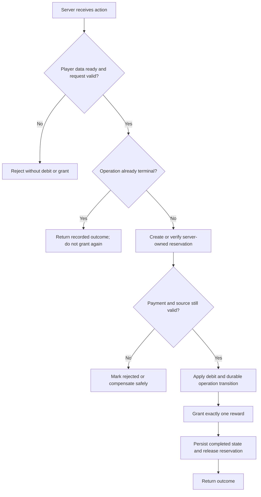

# Reconnect-Safe Action Standards

## Design Requirements

- Make the server the sole authority for price, eligibility, inventory, balance, cooldown, and reward calculation.
- Represent each value-changing action as a server-owned state machine: `new` → `reserved` → `paid` → `granted` → `completed` (or terminal `rejected` / `compensated`).
- Use an action key scoped to the player and logical operation. Persist the completion/claim state when reconnect, async work, or save boundaries can occur.
- Reserve or consume the one-time source before granting; do not release the reservation merely because the client disconnects.
- Revalidate the action and session/action generation after every asynchronous boundary before applying a mutation.
- Make repeated requests return the previously recorded outcome or a safe rejection. Never execute the grant again.
- On quit, either complete a durable terminal transition or cancel safely. On join, reconcile unfinished records before accepting new conflicting actions.
- Record a correlation key, debit, grant, status, and failure reason in telemetry. Do not treat telemetry as the replay-prevention mechanism.

## Anti-Patterns

- Client-only `_IsPending`, UI cooldowns, or local request tokens as the only duplicate prevention.
- `CheckCondition` followed by `wait`/`start` before reserving the action.
- Debiting and granting in independent callbacks without a durable shared operation state.
- Clearing pending maps on quit before delayed work is cancelled or fenced.
- Replaying a client request after reconnect without checking whether its logical action already completed.
- Writing only the balance or only the claimed-item marker when both are needed to recover safely.

## Review Checklist

- [ ] Is every value-changing client action routed to authoritative server logic?
- [ ] Does the server derive price and reward instead of trusting the payload?
- [ ] Is there a server-side reservation or single-consumption transition before a yield?
- [ ] Does the action have a replay-safe identity or an equivalent one-time server resource?
- [ ] Are debit, grant, and completion consistently ordered and recoverable?
- [ ] Can old-session callbacks mutate data after quit/reconnect?
- [ ] Are pending/lock records cleaned only after they become safe terminal states?
- [ ] Can reconnect spam produce more successful grants than accepted payments?
- [ ] For each trigger-driven reward intended to be limited, is server-side consumption/claim state recorded before grant rather than relying on a later teleport, despawn, or UI change?
- [ ] Are retry, database failure, timeout, and disconnect paths tested?

## Remediation Flow

## Test Scenarios

- Send the same request concurrently and confirm one accepted operation and one reward.
- Disconnect after request submission, after debit, after reward, and during save; reconnect with the same UUID and retry.
- Delay callbacks/database writes, then reconnect and spam the action before old work resumes.
- Force payment failure, reward failure, and save failure; verify no free grant and a deterministic recovery outcome.
- For a trigger reward followed by teleport/despawn, force duplicate trigger/event delivery before and after relocation; verify the intended claim limit is enforced server-side.
- Run the scenario across two devices/sessions if the platform permits overlapping identity sessions.

TODO: Adapt the reservation and durable-operation implementation to the target project's existing Manager, database, and transaction conventions; do not invent runtime APIs.
